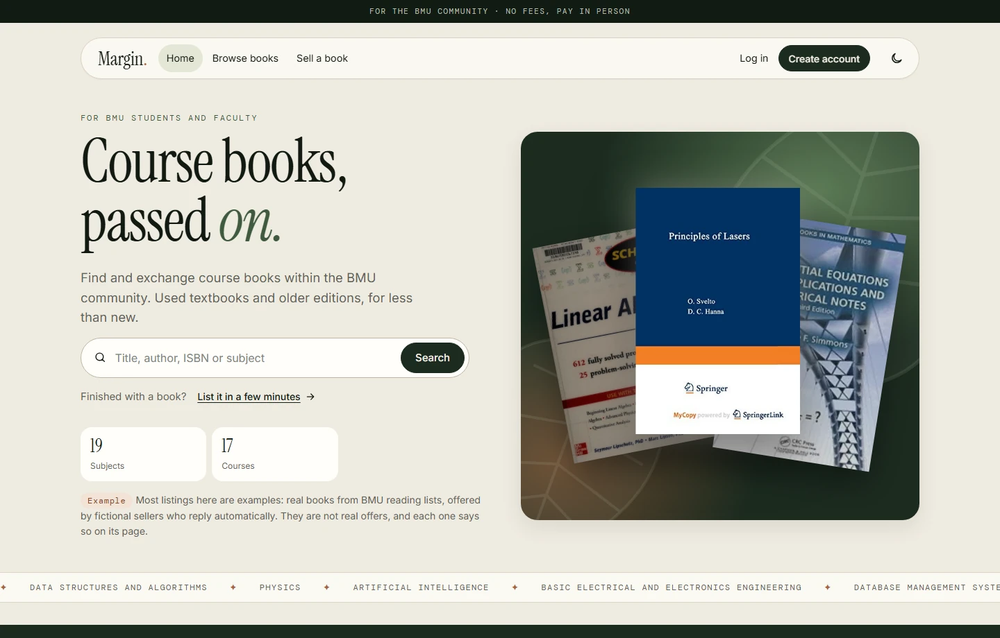
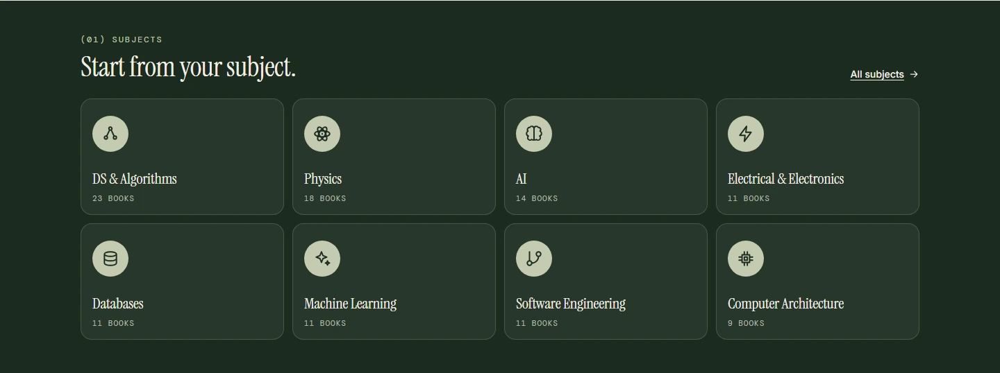
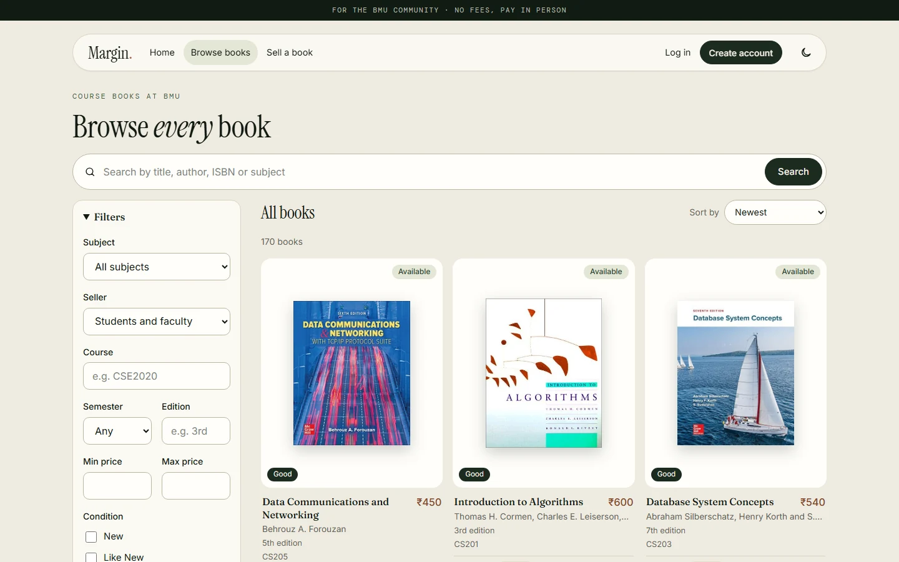
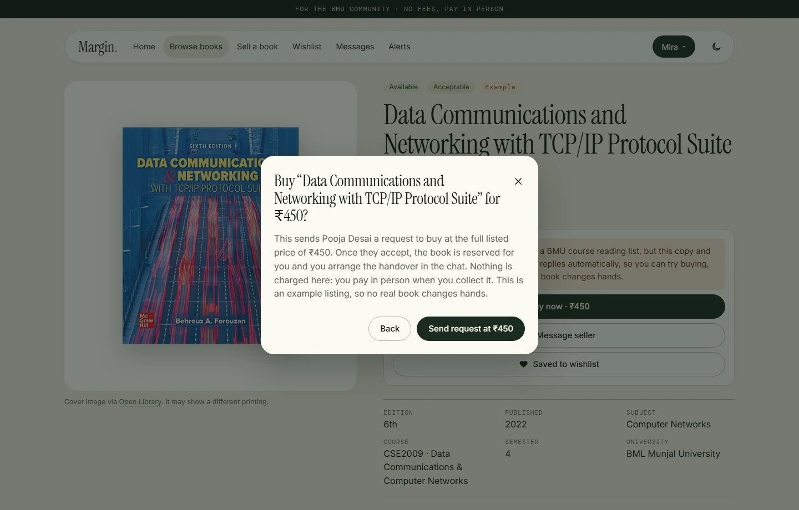
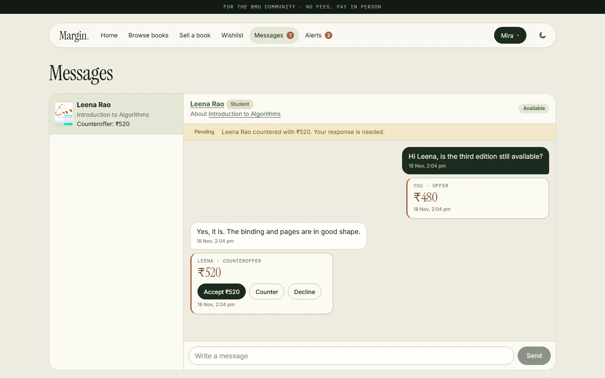
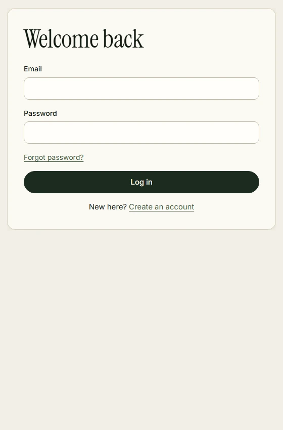
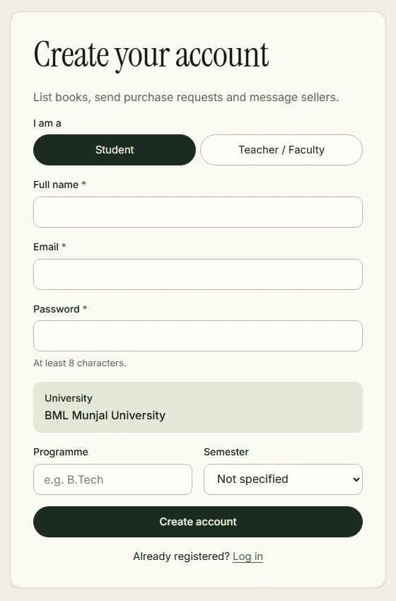

<h1 align="center">Margin</h1>
<p align="center"><strong>Course books, passed on.</strong></p>
<p align="center">A used textbook marketplace for BML Munjal University students and faculty.</p>

<p align="center">
  
  
  
  
</p>



<p align="center"><a href="#see-margin-in-action">Explore the marketplace</a> · <a href="#run-locally">Run locally</a></p>

## See Margin in action

### Start with a subject

Jump from the homepage to a subject shelf, or search by title, author, ISBN, subject, or course. Narrow the results by semester, condition, price, edition, or seller role.





### Find the right copy

Check the edition, condition, and asking price before contacting the seller. Save promising copies to your wishlist.


### Agree on a price and meet on campus

**Buy now** sends a request at the listed price. You can also make an offer and exchange counteroffers in the book's chat. Once the seller accepts, the book is reserved. Payment and handover happen in person.





### Pass on a book

Create a student or faculty account, then publish a listing with up to six photos, the book's condition, its course or subject, and your asking price.

<p align="center">
  
  
</p>


### Also built in

- **Stay up to date** with notifications, purchase requests, and exchange history.
- **Report a listing or user** for administrator review. Admins can manage reports, listings, and accounts.
- **Browse in light or dark mode** on phones and desktops.

## Technology stack

- **Frontend** · React 19, Vite, React Router
- **Backend** · Node.js, Express 5, Zod
- **Database** · MongoDB with Mongoose
- **Authentication** · bcrypt password hashing, JWT sessions in HTTP-only cookies, and optional Google sign-in

## Run locally

Requires **Node.js 22.12+** and a running **MongoDB 6.0+** instance. From the repository root:

```bash
npm install
cp server/.env.example server/.env
node -e "console.log(require('node:crypto').randomBytes(48).toString('hex'))"
```

In PowerShell, use `Copy-Item server/.env.example server/.env` for the copy step. Paste the generated value into `JWT_SECRET` in `server/.env`, and set `MONGODB_URI` to your database connection string. The template points to local MongoDB.

```bash
npm run seed:demo  # optional, adds the example marketplace to a local database
npm run dev
```

Open [localhost:5173](http://localhost:5173). The API runs on port 5000 by default. The screenshots use real books from BMU reading lists with fictional sellers and example prices.

<details>
<summary>Demo data, testing, and deployment</summary>

- **Demo catalogue** · Seeding is safe to rerun. For optional Open Library covers, run `node server/demo/verify-catalog.js --online` before seeding. Example sellers reply automatically in chat. Run `npm run demo:remove` to clear sample records and their activity. See the [catalogue review](server/demo/extraction-summary.md) for provenance.
- **Tests** · With MongoDB running, use `npm test` for the API suite. For browser tests, run `npx -w e2e playwright install chromium`, `npm run build`, then `npm run test:e2e`. Each suite uses a separate test database.
- **Production** · Run `npm run build`, then start with `NODE_ENV=production npm start` (PowerShell: `$env:NODE_ENV='production'; npm start`). Express serves the build. Use HTTPS for secure session cookies and set `TRUST_PROXY` to match your deployment.
- **Optional services** · The [environment template](server/.env.example) lists settings for Google sign-in, password-reset email, and Cloudinary uploads. Faculty roles are self-declared and email addresses are unverified.
- **Administration** · Create an administrator with `npm run create-admin -- "Admin Name" admin@example.edu "<password of at least 12 characters>"`. Preview subject migrations with `npm run migrate:subjects`.

</details>

## Documentation

Read the [final project report (PDF)](reports/Margin_Software_Engineering_Project_Report.pdf) or its [editable Word version](reports/Margin_Software_Engineering_Project_Report.docx). The [Software Engineering documentation](docs/README.md) includes the SRS, MoSCoW priorities, design, planning and test traceability.

The [MongoDB schema guide](reports/MongoDB_Schema_Explanation.md) explains the nine collections, references and unique indexes, with a [printable relationship diagram](reports/assets/mongodb-schema.svg). See the [publication checks](docs/04-Testing/evidence/publication-checks-2026-11-18.md) for the latest verification results.

## Project structure

```text
client/       React app, pages, and shared components
server/
  src/        Express API, data models, and middleware
  demo/       Reviewed course-book catalogue and seed logic
  scripts/    Demo data and administration commands
shared/       Subject catalogue used by the client and API
e2e/          Playwright browser tests
docs/         Requirements, design diagrams, planning, and test evidence
reports/      Final academic report and database schema documentation
```

---

Built by [Akshat Bhardwaj](https://github.com/akshat12bhardwaj) to help used course books find their next reader. Margin is an independent project with no affiliation with or endorsement from BML Munjal University.
