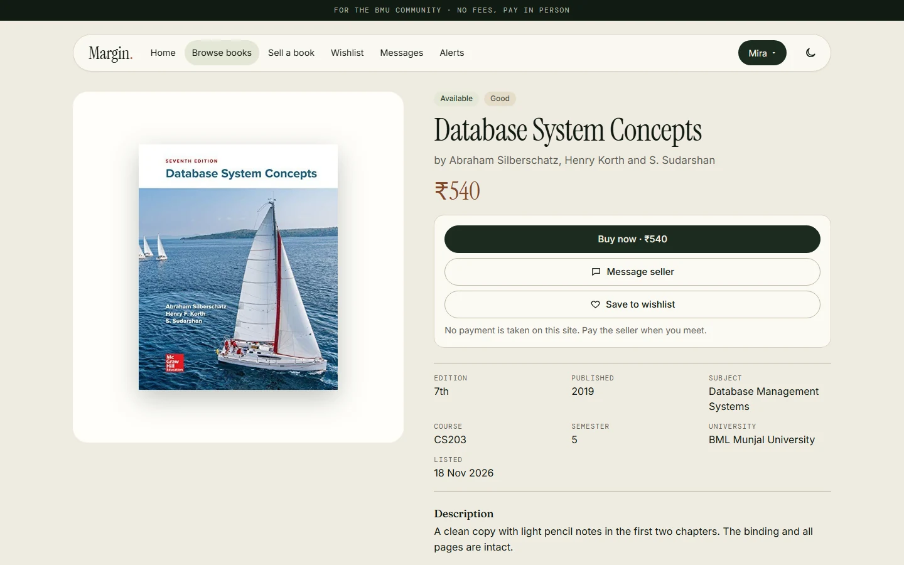
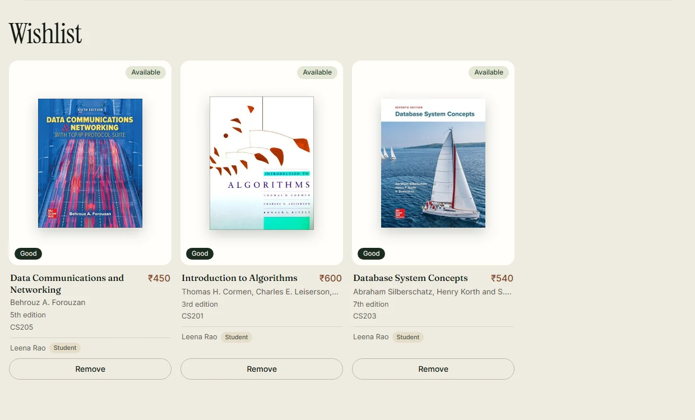
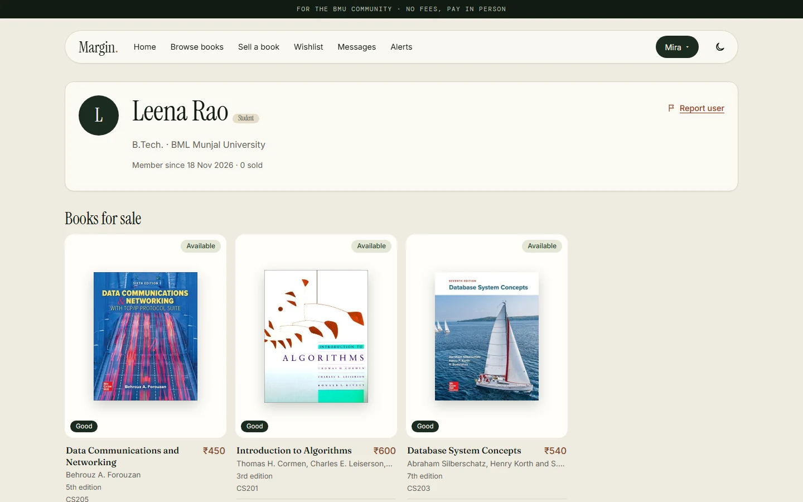
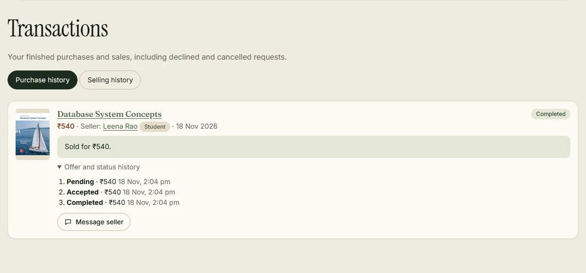
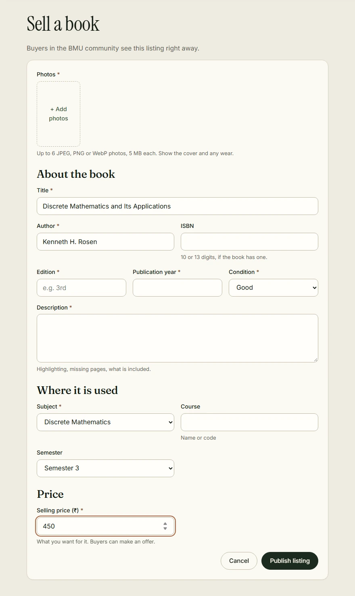
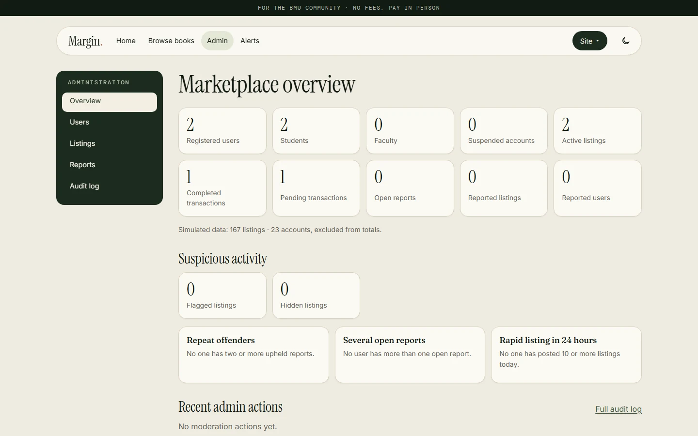

# Margin

A campus-focused marketplace where students and faculty can buy, sell and exchange course books.


Margin serves the BML Munjal University community. The screenshots use fictional accounts, prices, and conversations.

## Features

- **Discover books.** Browse subject shelves or search by title, author, ISBN, subject, or course. Filter by semester, edition, condition, price, or seller role.
- **Choose a copy.** Compare listing photos, editions, and prices, visit seller profiles, and save books to your wishlist.
- **Sell course books.** Publish listings with up to six photos. Edit, pause, reactivate, or remove them from My Listings.
- **Buy or negotiate.** Send a Buy Now request at the listed price or message the seller to make an offer and exchange counteroffers. Track open requests and review finished purchases and sales.
- **Moderate the marketplace.** Members can report listings and users. Administrators review reports, manage listings and accounts, and review moderation activity.

The layout adapts to phones, tablets, and desktops, with light and dark themes.


<details>
<summary>See subject shelves, listing details, wishlists, and seller profiles</summary>








</details>

## How Margin works

**Browse → Choose a book → Buy Now or negotiate in chat → Agree on a price → Arrange handover → Complete the exchange**

When the seller accepts the request, or the buyer accepts the seller’s counteroffer, the listing is reserved. Both parties arrange pickup in chat and settle payment in person. The seller marks the book as sold after handover, and the exchange appears in Transactions.


<details>
<summary>See Buy Now and transaction history</summary>




</details>

<details>
<summary>See the listing form and administrator dashboard</summary>





</details>

## Technology stack

**Frontend** React and Vite · **API** Node.js and Express · **Database** MongoDB and Mongoose · **Browser testing** Playwright

## Getting started

Requires **Node.js 22.12 or later** and a running **MongoDB 6.0 or later** instance.

```sh
git clone https://github.com/akshat12bhardwaj/Margin.git
cd Margin
npm ci
node -e "const fs = require('node:fs'); const secret = require('node:crypto').randomBytes(48).toString('hex'); const template = fs.readFileSync('server/.env.example', 'utf8'); fs.writeFileSync('server/.env', template.replace(/^JWT_SECRET=/m, 'JWT_SECRET=' + secret), { flag: 'wx' });"
```

Keep an existing `server/.env` if you already have one. The template points to local MongoDB. Set `MONGODB_URI` in `server/.env` if your database uses a different connection string.

```sh
npm run seed:demo
npm run dev
```

Demo seeding is optional. It adds a sample catalogue with fictional sellers and automated replies. Open [localhost:5173](http://localhost:5173).

## Testing

Verified on **18 November 2026**. The production build succeeded, **67 of 67 API tests passed**, and **16 of 16 Chromium tests passed**.

With local MongoDB running on port 27017, run from the repository root:

```sh
npm test
npx -w e2e playwright install chromium
npm run build
npm run test:e2e
```

The API and browser suites reset their own test databases.

## Documentation

- [Software Engineering project report](reports/Margin_Software_Engineering_Project_Report.pdf)
- [Database schema diagram](reports/assets/mongodb-schema.svg) and [schema guide](reports/MongoDB_Schema_Explanation.md)
- [Software Requirements Specification](docs/01-SRS/SRS.md)
- [Software design](docs/02-Software-Design/Software-Design.md)
- [Test plan and report](docs/04-Testing/Test-Plan-and-Report.md) and [publication checks](docs/04-Testing/evidence/publication-checks-2026-11-18.md)

## Contributors

| Name | Enrollment Number |
| --- | --- |
| Akshat Bhardwaj | 240373 |
| Abhishek Rana | 240366 |
| Ali Zamaan | 240374 |
| Bhanu Pratap Singh | 240423 |
