# Software Design Document: Margin

Course book exchange marketplace · CSE3005 Software Engineering · BML Munjal University

Version 1.0 · 6 November 2026 · Prepared by: Margin project team

## 1. Purpose and sources

This document describes how Margin is built. It covers the architecture, UML models (use case, class, sequence, state), data flow diagrams (context, level 0 and level 1), the database design and the design principles followed. It implements the requirements in the SRS (docs/01-SRS); requirement IDs (FR-xx) refer to that document.

The models were derived from the implemented code, not drawn beforehand: the class diagram and database tables come from the Mongoose schemas in `server/src/models`, the sequence diagrams follow the route handlers in `server/src/routes`, and the use cases follow the pages in `client/src/pages`. Each figure is generated from a source file in `diagrams/src`, so a change to the design is made in one place and re-rendered (`node docs/02-Software-Design/diagrams/src/render.mjs`). While rendering, the script checks that the DFD levels are balanced and that no flow connects an external entity or store directly to a store; rendering stops if a check fails.

## 2. Architecture

Margin uses a three-tier client–server architecture (Figure 2.13).

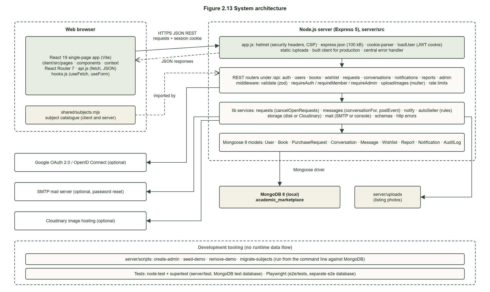

| Tier | Technology | Responsibility |
| --- | --- | --- |
| Presentation | React 19 single-page app built with Vite, React Router 7 | Pages, forms, client-side checks, rendering of server data. Talks to the server only through `client/src/api.js` |
| Application | Node.js with Express 5 | REST API under `/api`: authentication, validation (zod), authorisation, business rules, notifications, automated-seller rules |
| Data | MongoDB 8 through Mongoose 9; image files on disk or Cloudinary | Persistent storage, uniqueness and integrity constraints |

Requests pass through a fixed pipeline in `server/src/app.js`: security headers (helmet), JSON body limit of 100 kB, cookie parsing, `loadUser` (verifies the session cookie), the router for the path, route-level guards and validation, and finally the central error handler. In production the same server also serves the built client.

The subject catalogue (`shared/subjects.mjs`) is the one module imported by both client and server. It ensures the form, the filters and the server validation use exactly the same 39 subjects.

### 2.1 REST API summary

| Area | Endpoints (prefix `/api`) | Guard |
| --- | --- | --- |
| Auth | `POST /auth/register`, `/auth/login`, `/auth/logout`, `/auth/forgot-password`, `/auth/reset-password`, `/auth/change-password`; `GET /auth/me`; `GET /auth/google`, `/auth/google/callback`; `POST /auth/google/complete` | Rate limited; change-password needs a session |
| Users | `PATCH /users/me`, `GET /users/me/dashboard`, `GET /users/:id` | Active member for edits; public profile open |
| Books | `GET /books`, `/books/facets`, `/books/mine`, `/books/:id`; `POST /books`; `PATCH /books/:id`, `/books/:id/status`; `DELETE /books/:id` | Reads open; writes need an active member who owns the listing |
| Wishlist | `GET /wishlist`, `POST /wishlist`, `DELETE /wishlist/:id` | Active member |
| Requests | `POST /requests`; `GET /requests`; `PATCH /requests/:id/accept`, `/reject`, `/counter`, `/cancel`, `/complete`; `POST /requests/:id/conversation` | Active member who is a party to the request |
| Conversations | `POST /conversations`, `GET /conversations`, `GET /conversations/:id`, `POST /conversations/:id/messages` | Party to the conversation; 30 messages per minute |
| Notifications | `GET /notifications`, `/notifications/summary`; `PATCH /notifications/read-all`, `/notifications/:id/read` | Logged in |
| Reports | `POST /reports` | Active member; 20 per hour |
| Admin | `GET /admin/stats`, `/admin/users`, `/admin/users/:id`, `/admin/books`, `/admin/books/:id`, `/admin/reports`, `/admin/audit-logs`; `PATCH /admin/users/:id/suspend`, `/deactivate`, `/restore`; `PATCH /admin/books/:id/hide`, `/remove`, `/restore`; `PATCH /admin/reports/:id` | Administrator only |

## 3. Use-case model

Figure 2.1 shows the actors and use cases. A member (student or faculty) can do everything a visitor can, shown by generalisation. Relationships are used only where the code shares behaviour:

- «include»: Buy now and Make an offer both create a purchase request through the same function (`createRequest` in `routes/requests.js`). Every administrator moderation action writes an audit entry (`audit()` in `routes/admin.js`).
- «extend»: filtering is optional behaviour added to browsing; Google sign-in is an alternative way to log in.

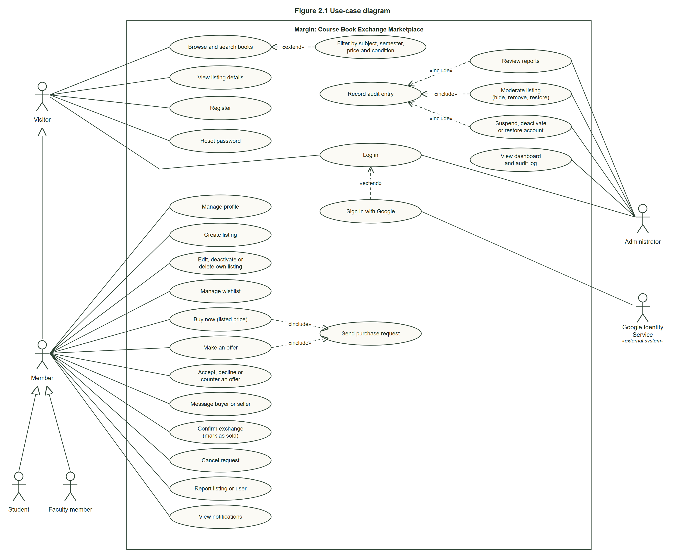

Automated example sellers are not actors: they are part of the system (FR-28), and their replies are produced on the server when a real member acts.

## 4. Class diagram

Figure 2.2 models the nine MongoDB collections. Attributes are those stored in the documents; operations are the API actions that change each document. References are stored as ObjectIds. Wishlist is an association class between User and Book. A Conversation owns its Messages (composition), and offer and decision messages point to the purchase request they record.

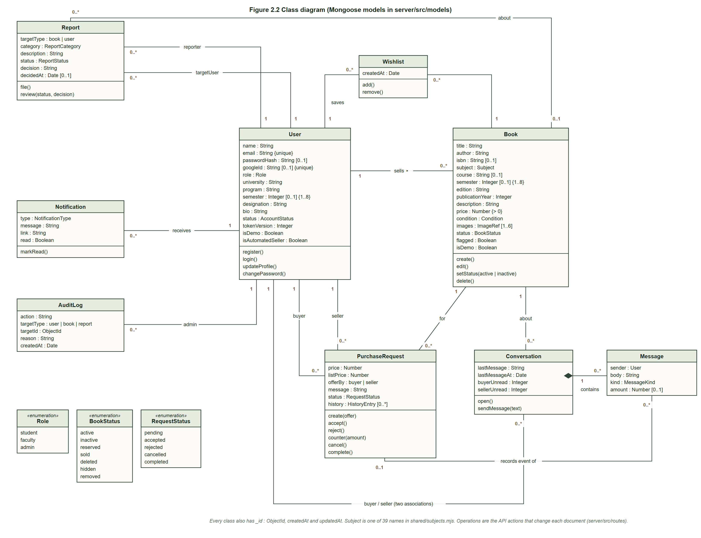

## 5. Behaviour: sequence diagrams

The five required workflows are shown in Figures 2.3 to 2.8 (authentication has two figures). Numbered messages follow the order of calls in the code.

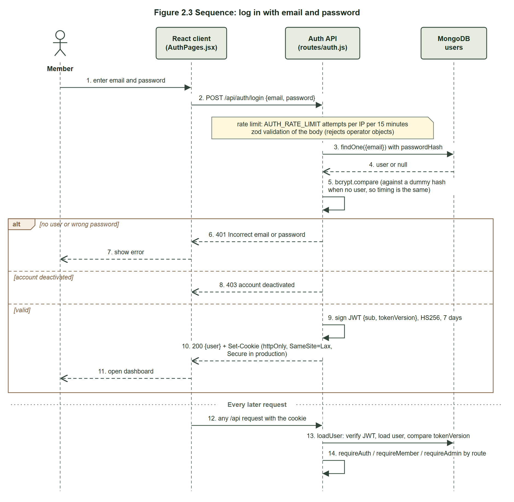

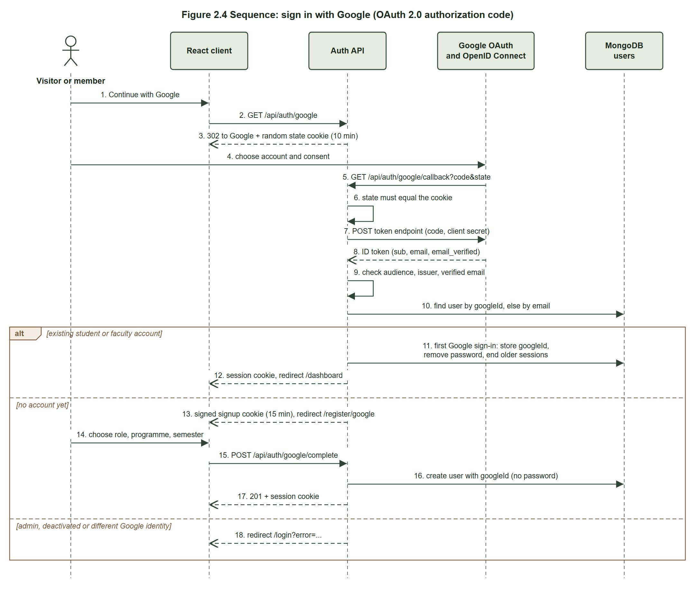

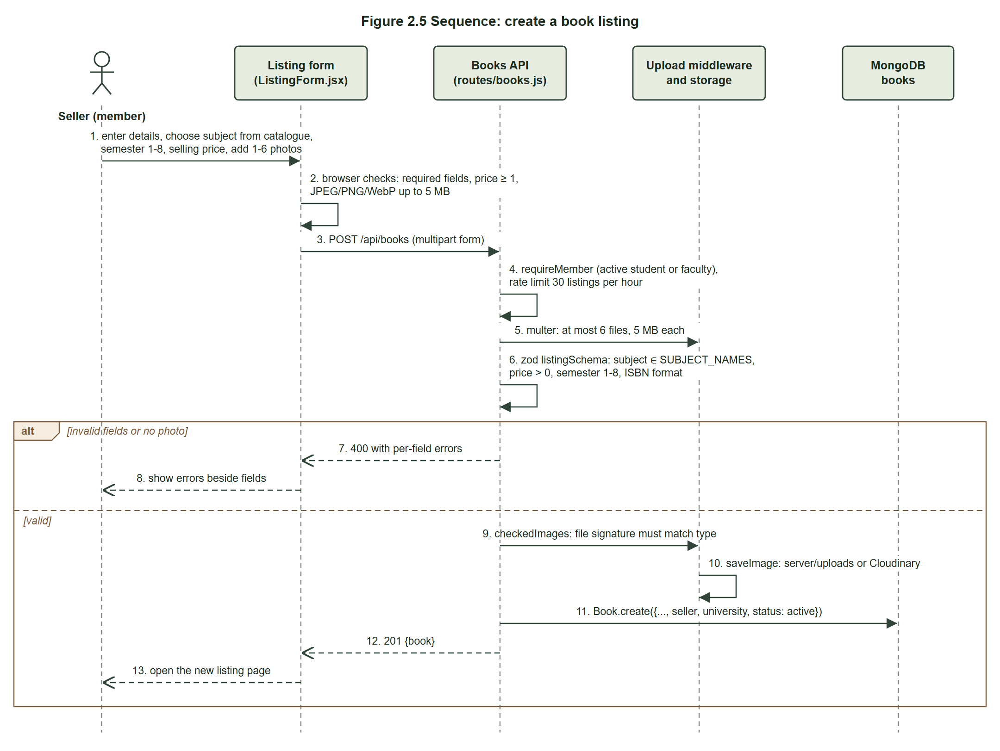

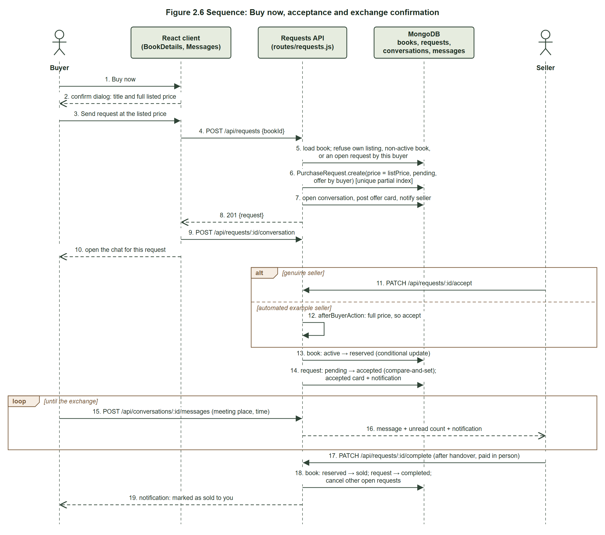

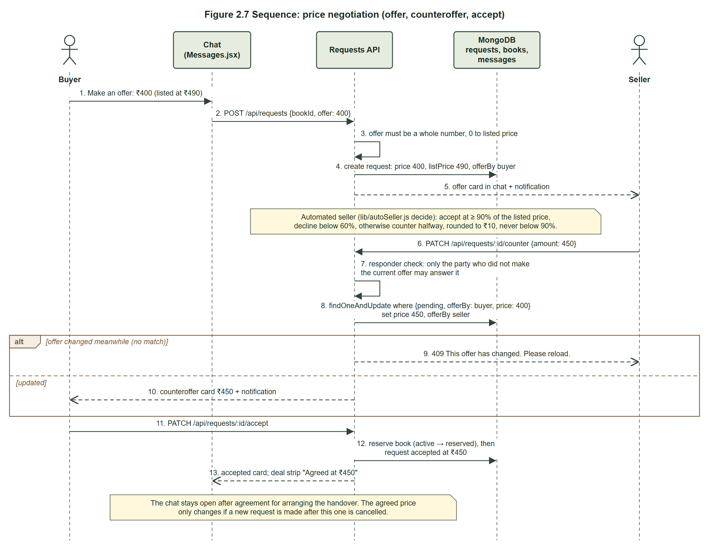

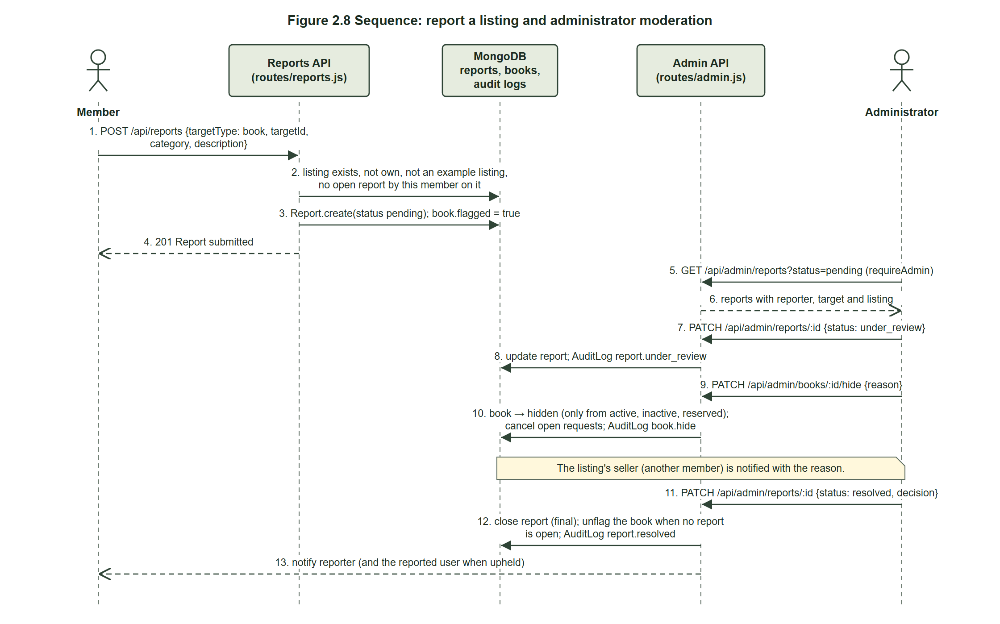

## 6. Data flow diagrams

The DFDs use Yourdon–DeMarco notation: circles are processes, open-ended rectangles are data stores, shaded squares are external entities, and arrows carry the named data. A double-headed arrow means a process both reads and writes the store. An entity or store drawn twice is marked with an asterisk and a corner stroke.

Balancing rules, checked automatically when the diagrams are rendered:

1. Every flow between an external entity and the system in the context diagram appears in level 0 between that entity and a process, and level 0 has no other external flows.
2. Every flow into or out of process 5.0 and process 8.0 at level 0 appears at level 1 on the boundary of that process. A level 1 flow labelled with a part (for example "exchange confirmation") is a component of the named level 0 flow.
3. No flow goes directly from an external entity to a store, or from one store to another.

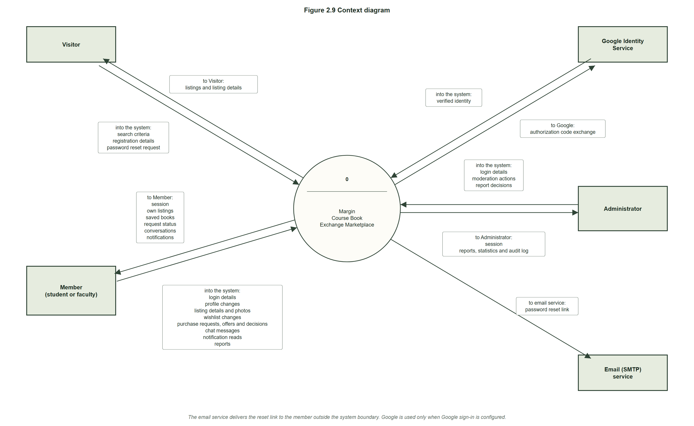

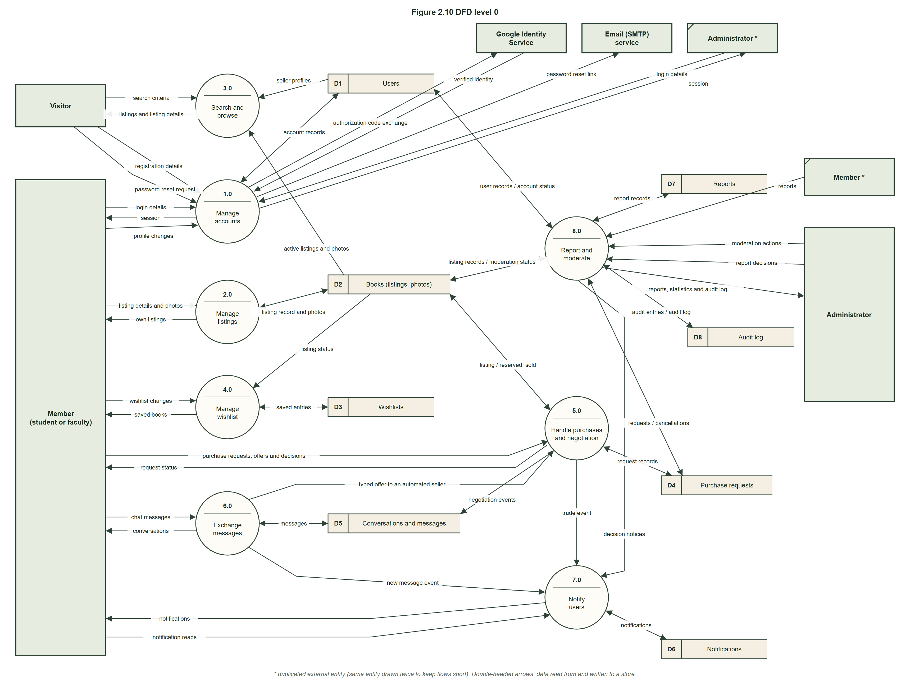

Level 0 has eight processes and eight logical stores. D2 holds listing records and their photos; physically the photo files are kept in `server/uploads` (or Cloudinary) and referenced from the listing. Level 1 is given for the two processes with the most internal logic.

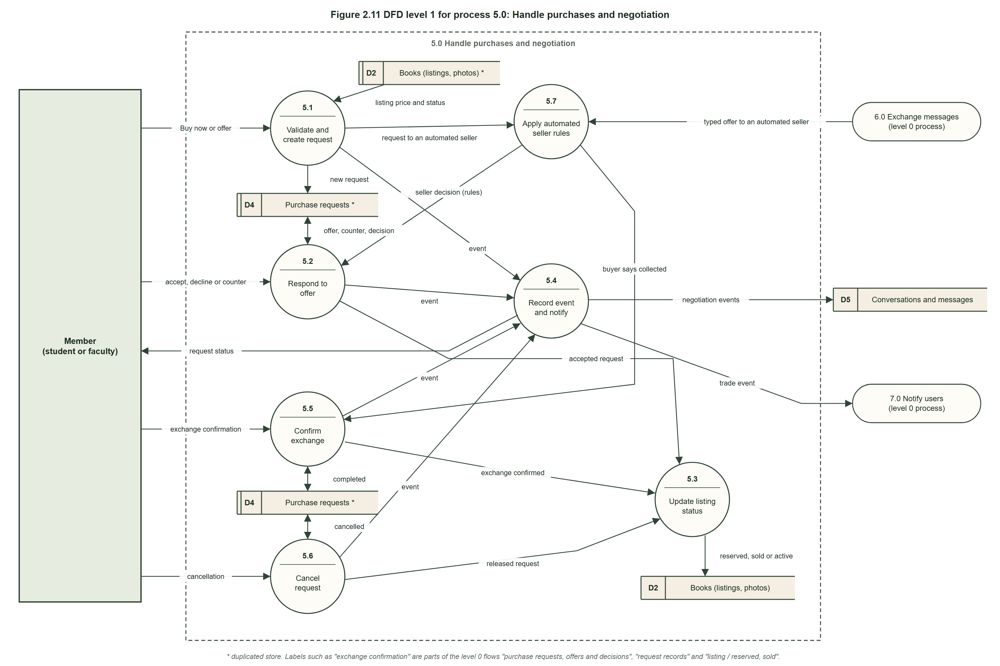

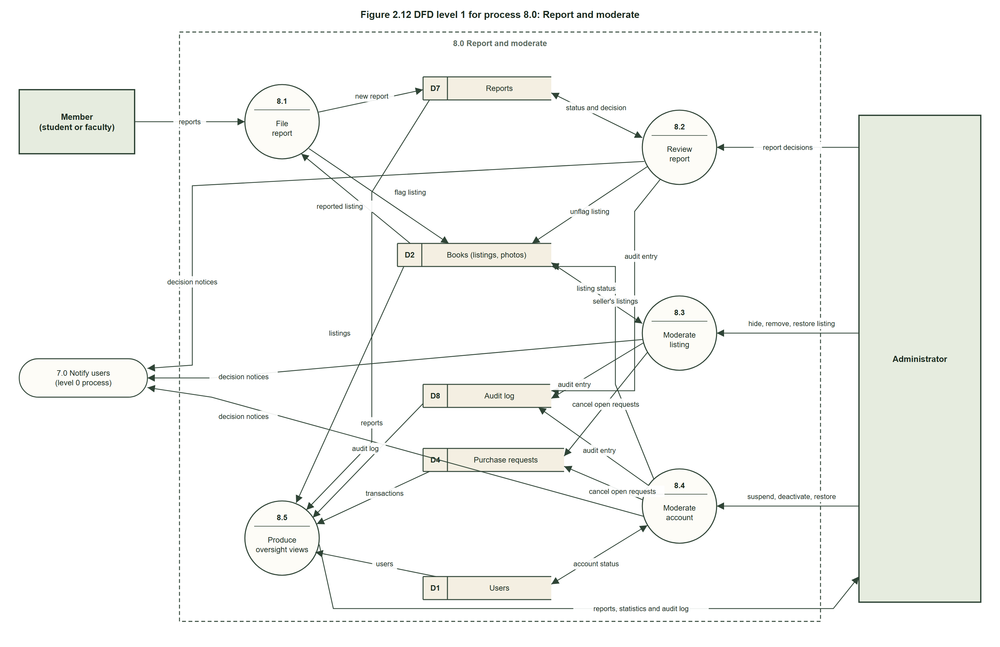

## 7. Database design

MongoDB database `academic_marketplace`. Every document has `_id`, and all collections except `auditlogs` have `createdAt` and `updatedAt`.

| Collection | Important fields | References | Constraints and indexes |
| --- | --- | --- | --- |
| users | name, email, passwordHash, googleId, role, university, program, semester, designation, bio, status, tokenVersion, isDemo, isAutomatedSeller, reset token hash and expiry | – | email unique; googleId unique (sparse); role ∈ {student, faculty, admin}; status ∈ {active, suspended, deactivated}; semester 1–8; passwordHash, googleId, tokenVersion and reset fields are never selected by default. Index (role, status, createdAt) |
| books | title, author, isbn, subject, course, semester, edition, publicationYear, description, price, condition, images[1..6], status, flagged, moderationReason, hiddenBySuspension, isDemo, demoKey, coverNote | seller → users | subject validated against the catalogue by the API; price > 0 for new listings; isbn 10 or 13 digits; status ∈ {active, inactive, reserved, sold, deleted, hidden, removed}. Indexes on status with createdAt, price, subject, university and publicationYear; (seller, status); (flagged, status); demoKey unique (sparse) |
| purchaserequests | price (current offer or agreed price), listPrice, offerBy, message, status, history[] of {status, by, note, amount, at}, isDemo | book → books; buyer, seller → users | status ∈ {pending, accepted, rejected, cancelled, completed}. Partial unique (book, buyer) while pending or accepted: one open request per buyer per listing. Partial unique (book) while accepted or completed: at most one winning buyer. Indexes (buyer, status, createdAt), (seller, status, createdAt) |
| conversations | lastMessage, lastMessageAt, buyerUnread, sellerUnread, isDemo | book → books; buyer, seller → users | Unique (book, buyer); indexes (buyer, lastMessageAt), (seller, lastMessageAt) |
| messages | body (≤ 2000), kind, amount | conversation → conversations; sender → users; request → purchaserequests | kind ∈ {text, offer, counter, accepted, rejected, cancelled, completed}. Index (conversation, createdAt) |
| wishlists | – | user → users; book → books | Unique (user, book); index (user, createdAt) |
| reports | targetType, category, description, status, decision, decidedAt | reporter, targetUser, decidedBy → users; book → books | status ∈ {pending, under_review, resolved, rejected}. Partial unique (reporter, targetUser, book) while open; indexes (status, createdAt), (targetUser, status), (book, status) |
| notifications | type, message, link, read | user → users | type ∈ {request, message, report, moderation, account}. Indexes (user, createdAt), (user, read) |
| auditlogs | action, targetType, targetId, reason, createdAt | admin → users | Append-only (no update route). Indexes (createdAt), (targetType, targetId, createdAt) |

Two legacy fields remain for records created before the current version: `books.department` and `users.department` are no longer collected or shown, and `books.originalPrice` is excluded from every query result. `npm run migrate:subjects` maps older subject text onto the catalogue and flags anything it cannot map; it removes stored original prices only when run with `--remove-original-price`.

### 7.1 Transaction states

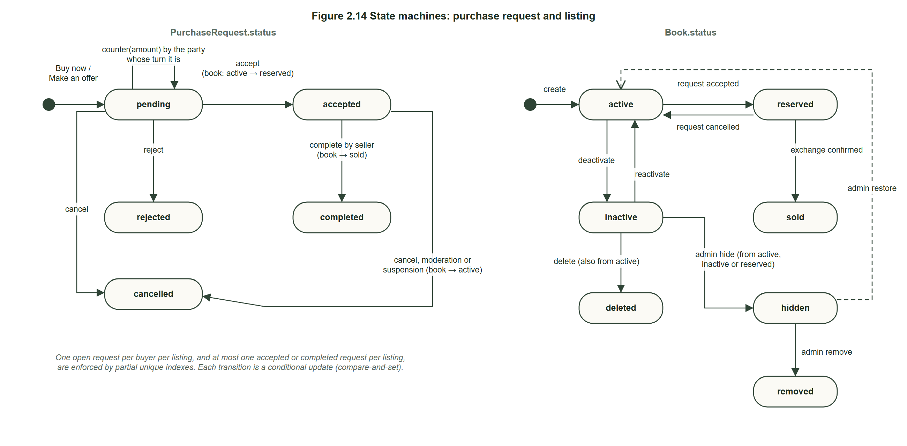

Acceptance first reserves an active listing, then conditionally accepts the current offer. A failed request transition releases the tentative reservation. The partial unique indexes prevent a second winning request for the same book.

Verified on 17 November 2026: cancellation changes the request first and uses the state replaced by that write to decide whether to release the listing. It therefore releases an accepted reservation even when acceptance finished after the cancellation initially read the request. The tests cover both overlap orders. These updates use separate documents without a database transaction. A process interruption between writes remains a separate recovery concern.

## 8. Design principles applied

| Principle | How it appears in Margin |
| --- | --- |
| Modularity | One router per resource (`server/src/routes`), one model per collection, and shared services in `server/src/lib` (notifications, messages, request cancellation, storage, mail, automated-seller rules). Client pages are separate modules, with shared components in `client/src/components` |
| High cohesion | Each module has one job: `middleware/validate.js` only validates, `lib/notify.js` only creates notifications, `lib/autoSeller.js` holds every automated-seller rule. The subject catalogue is a single data module |
| Low coupling | The client knows the server only through HTTP and `api.js`. The automated seller does not change listings itself: it calls the same `ACTIONS` handlers as a human seller, so turn order, reservation and history rules cannot diverge. Optional services (Google, SMTP, Cloudinary) are switched on by configuration and do not change calling code |
| Separation of concerns | Validation (zod schemas at the route boundary), authorisation (guards), business rules (handlers and `lib`) and persistence (models) are separate layers. Rules that protect data, such as uniqueness and allowed states, are also enforced by the database |
| Maintainability | Configuration in environment variables (`server/.env.example`), central error handling, scripts for repeatable operations (seeding, removal, migration, admin creation), and 80 automated tests that run before every change is accepted |
| Defensive design | Server-side validation even when the client also checks; conditional updates instead of read-then-write; secrets excluded from query results by default (`select: false`) |
