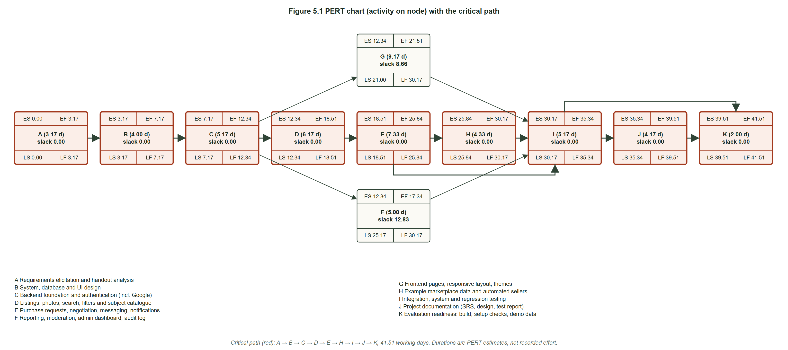

# Software Project Management: Margin

Course book exchange marketplace · CSE3005 Software Engineering · BML Munjal University

Version 1.0 · 6 November 2026 · Prepared by: Margin project team

All durations, effort and costs in this document are **estimates** made with the stated assumptions. They are not recorded effort or actual expenses: no time sheets or expense records exist for the project. The calculations are reproducible with `node docs/05-Project-Management/pert-cpm.mjs`, whose output is saved in `pert-cpm-output.md`.

## 1. Work breakdown structure

| WBS | Work package | Deliverables | Activity |
| --- | --- | --- | --- |
| 1 | Project management | Plan, estimates, risk register, development milestones | spans all |
| 2 | Requirements | Problem analysis, handout analysis, SRS with MoSCoW priorities | A |
| 3 | Design | Architecture, database design, UML and DFD models, UI design system | B |
| 4 | Implementation | | |
| 4.1 | Backend foundation and accounts | Express app, models, authentication, Google sign-in, password reset | C |
| 4.2 | Listings and discovery | Listing CRUD, photo upload, subject catalogue, search and filters, wishlist | D |
| 4.3 | Trading and communication | Purchase requests, Buy now, negotiation, reservation, messaging, notifications | E |
| 4.4 | Trust and moderation | Reports, moderation, account control, dashboard, audit log | F |
| 4.5 | Frontend | All member and administrator pages, responsive layout, themes, home showcase | G |
| 4.6 | Example marketplace | Handout extraction, example listings, automated sellers, seed and removal scripts | H |
| 5 | Testing | API and browser test suites, performance sample, test report | I |
| 6 | Documentation | SRS, design document, SDLC, test report, this document, quality and maintenance | J |
| 7 | Evaluation readiness | Production build, setup instructions, demo data, final checks | K |

## 2. Effort estimation

### 2.1 Three-point estimates per activity

Assumptions: durations are working days of one developer-equivalent at six productive hours a day; estimates come from the size of each module in the delivered code and the number of tests it needed. O = optimistic, M = most likely, P = pessimistic.

| ID | Activity | Predecessors | O | M | P | tₑ = (O+4M+P)/6 | Variance ((P−O)/6)² |
| --- | --- | --- | --- | --- | --- | --- | --- |
| A | Requirements elicitation and handout analysis | – | 2 | 3 | 5 | 3.17 | 0.25 |
| B | System, database and UI design | A | 2 | 4 | 6 | 4.00 | 0.44 |
| C | Backend foundation and authentication (incl. Google) | B | 3 | 5 | 8 | 5.17 | 0.69 |
| D | Listings, photos, search, filters and subject catalogue | C | 4 | 6 | 9 | 6.17 | 0.69 |
| E | Purchase requests, negotiation, messaging, notifications | D | 5 | 7 | 11 | 7.33 | 1.00 |
| F | Reporting, moderation, admin dashboard, audit log | C | 3 | 5 | 7 | 5.00 | 0.44 |
| G | Frontend pages, responsive layout, themes | C | 6 | 9 | 13 | 9.17 | 1.36 |
| H | Example marketplace data and automated sellers | E | 3 | 4 | 7 | 4.33 | 0.44 |
| I | Integration, system and regression testing | E, F, G, H | 3 | 5 | 8 | 5.17 | 0.69 |
| J | Project documentation (SRS, design, test report) | I | 3 | 4 | 6 | 4.17 | 0.25 |
| K | Evaluation readiness: build, setup checks, demo data | I, J | 1 | 2 | 3 | 2.00 | 0.11 |

Total estimated effort: **55.68 developer-days** (about 334 hours).

### 2.2 Cross-check with basic COCOMO

The delivered production code has 6,394 non-blank lines (client 3,942; server 1,942; scripts and example-data code 435; shared catalogue 75; tests excluded), measured on 6 November 2026. Basic COCOMO in organic mode gives:

- Effort E = 2.4 × 6.39^1.05 = **16.8 person-months**
- Schedule D = 2.5 × 16.8^0.38 = **7.3 months**, average staff 2.3

COCOMO is roughly six times the bottom-up estimate. Its coefficients come from 1970s projects written largely from scratch, while Margin relies heavily on frameworks (React, Express, Mongoose, Playwright) and has a small team with no hand-offs. The bottom-up PERT estimate is used for planning; COCOMO is reported as an upper bound.

## 3. Time estimation and schedule

The schedule below is in working days from the project start (day 0). Calendar dates are not assigned because no planned start date was recorded. The course's lab evaluations (October weeks 3 and 4, November weeks 1 and 4, 2026, per the course handout) are the external milestones the schedule must fit.

| Milestone | Planned end (working day) | Depends on |
| --- | --- | --- |
| SRS baseline | 3.17 | A |
| Design baseline | 7.17 | B |
| Core marketplace working (accounts, listings, trading) | 25.84 | C, D, E |
| Feature complete | 30.17 | F, G, H |
| Testing complete | 35.34 | I |
| Documentation complete | 39.51 | J |
| Ready for evaluation | 41.51 | K |

## 4. PERT chart

Expected duration along the critical path is **41.51 working days** with a standard deviation of **2.14 days** (square root of the sum of critical-path variances, 4.58). Assuming a normal distribution, the probability of finishing within T days is Φ((T − 41.51) / 2.14):

| Target | z | Probability |
| --- | --- | --- |
| 40 days | −0.71 | 24.0% |
| 42 days | 0.23 | 59.1% |
| 44 days | 1.16 | 87.8% |

## 5. Critical path method

Forward pass: ES = latest EF of the predecessors, EF = ES + duration. Backward pass: LF = earliest LS of the successors, LS = LF − duration. Slack = LS − ES.

| ID | Duration | ES | EF | LS | LF | Slack | Critical |
| --- | --- | --- | --- | --- | --- | --- | --- |
| A | 3.17 | 0.00 | 3.17 | 0.00 | 3.17 | 0.00 | Yes |
| B | 4.00 | 3.17 | 7.17 | 3.17 | 7.17 | 0.00 | Yes |
| C | 5.17 | 7.17 | 12.34 | 7.17 | 12.34 | 0.00 | Yes |
| D | 6.17 | 12.34 | 18.51 | 12.34 | 18.51 | 0.00 | Yes |
| E | 7.33 | 18.51 | 25.84 | 18.51 | 25.84 | 0.00 | Yes |
| F | 5.00 | 12.34 | 17.34 | 25.17 | 30.17 | 12.83 | No |
| G | 9.17 | 12.34 | 21.51 | 21.00 | 30.17 | 8.66 | No |
| H | 4.33 | 25.84 | 30.17 | 25.84 | 30.17 | 0.00 | Yes |
| I | 5.17 | 30.17 | 35.34 | 30.17 | 35.34 | 0.00 | Yes |
| J | 4.17 | 35.34 | 39.51 | 35.34 | 39.51 | 0.00 | Yes |
| K | 2.00 | 39.51 | 41.51 | 39.51 | 41.51 | 0.00 | Yes |

**Critical path: A → B → C → D → E → H → I → J → K (41.51 days).** Moderation (F) and the frontend (G) have 12.83 and 8.66 days of slack, so they can absorb delays or share people with critical work. A delay to listings (D) or trading (E) delays the whole project day for day. The calculation script asserts that no activity has negative slack and that the critical path runs from day 0 to the project end.

## 6. Cost estimation

| Item | Basis | Estimate (₹) |
| --- | --- | --- |
| Development labour | 55.68 developer-days × ₹1,500 per day (assumed student-intern rate, about ₹30,000 a month) | 83,520 |
| Contingency | 15% of labour, covering the 2.14-day schedule deviation and requirement changes | 12,528 |
| Software and tools | Node.js, MongoDB Community, React, Express, Playwright, VS Code: free and open source | 0 |
| Hardware | Existing laptops; no purchase | 0 |
| Hosting and domain | Not incurred: the system runs locally for evaluation | 0 |
| **Total estimate** | | **96,048** |

At the same rate, the COCOMO effort (16.8 person-months × ₹30,000) would be ₹5,04,000. If the system were deployed, hosted MongoDB, an application host and an SMTP provider would add running costs; providers' free tiers would cover campus-scale use, but these have not been priced because no deployment is planned.

## 7. Risk management

Likelihood and impact: L = low, M = medium, H = high.

| ID | Risk | Likelihood | Impact | Mitigation in place | Response if it occurs |
| --- | --- | --- | --- | --- | --- |
| R1 | Authentication failure or account takeover | M | H | bcrypt hashes; per-IP login limit; httpOnly cookies; generic login errors; Google linking removes the old password and ends sessions | Administrator deactivates the account; a password reset bumps the token version and ends every session |
| R2 | Data loss | M | H | Seed, removal and migration scripts are idempotent, refuse production and remote databases by default, and the migration has a dry run; a backup was taken before the subject migration | Restore from the most recent `mongodump` backup. Scheduled backups are not yet automated (open action) |
| R3 | Duplicate reservations or double sale | L | H | Conditional updates plus two partial unique indexes; startup fails if an index cannot be built; concurrency tests (TC-27, TC-28) | Cancel the extra request; the database refuses the second winner regardless |
| R4 | Fraudulent or misleading listings | M | M | Reporting with categories; moderation with reasons; audit log; no payment before meeting | Hide or remove the listing, suspend the seller, notify affected buyers |
| R5 | Unauthorised access to data or actions | L | H | Guards on every route; ownership checks that return 404; private fields never selected | Fix the route, then review the audit log for misuse |
| R6 | Messaging failures | L | M | Messages are stored before being shown; the open chat refreshes every 5 seconds | Reload the conversation; messages are not lost because they are persisted first |
| R7 | Database unavailable | L | H | The server refuses to start without MongoDB (5-second timeout) instead of running half-working | Restart MongoDB; restore from backup if its files are damaged |
| R8 | Optional external services unavailable (Google, SMTP) | M | L | Password login always works; reset links fall back to the console in development | Members use email and password until Google returns |
| R9 | Late requirement changes | H | M | Incremental process; full regression suite; data migrations instead of resets | Re-plan the next increment; re-run all tests |
| R10 | Schedule slip before an evaluation | M | M | Work prioritised by MoSCoW; critical path monitored; slack in F and G | Move "Could have" items (FR-27 to FR-29) out of the release |
| R11 | No version control | H | M | the project milestones recorded in the SDLC document records every increment and its test results | Put the repository under Git with a remote; until then, copy the folder before large changes |

## 8. Project monitoring and control

- **Progress tracking:** `the project milestones recorded in the SDLC document` holds one section per increment. Each subgoal is marked COMPLETED only with its evidence (test counts, pages checked). Items not done are listed under "Not done" instead of being hidden.
- **Quality gate:** a subgoal is complete only when `npm test`, `npm run test:e2e` and `npm run build` all succeed, so the test counts in the project milestones recorded in the SDLC document (38 → 51 → 55 → 61 → 64 API tests) are the main progress metric.
- **Defect tracking:** defects found by tests or review are recorded with their fix in the project milestones recorded in the SDLC document ("Bugs found and fixed") and covered by a regression test where possible.
- **Change control:** each change request is checked for its effect on stored data before implementation. Data changes go through a dry run (for example `npm run migrate:subjects`), irreversible steps need explicit approval, and listing counts are compared before and after.
- **Schedule control:** actual progress is compared with the critical path. Delays on D, E, H or I need immediate action; delays on F or G are absorbed by their slack.
